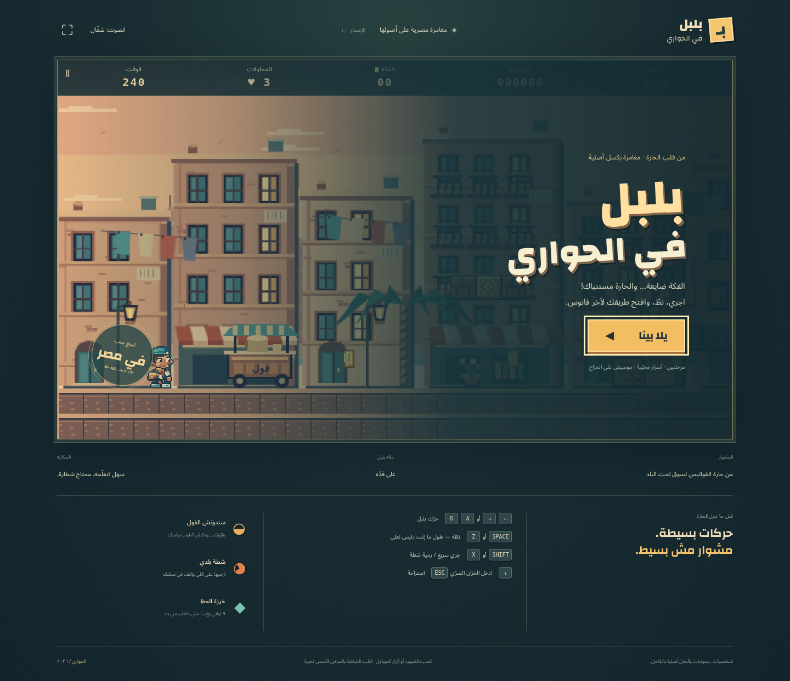
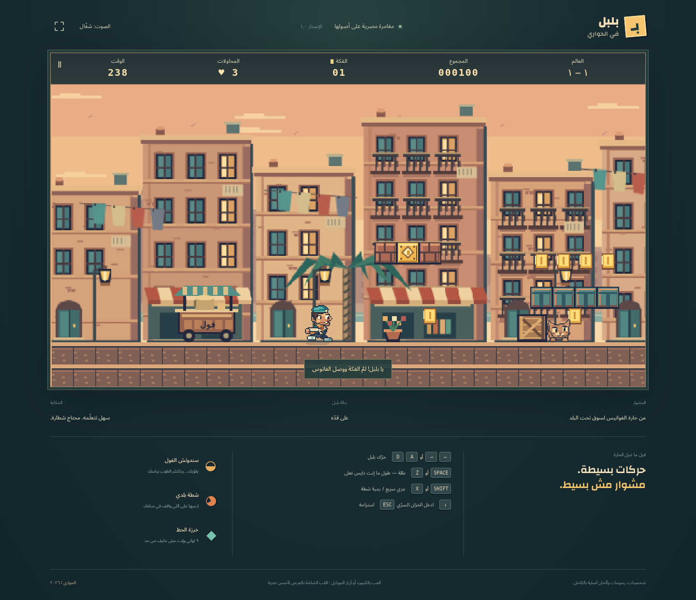
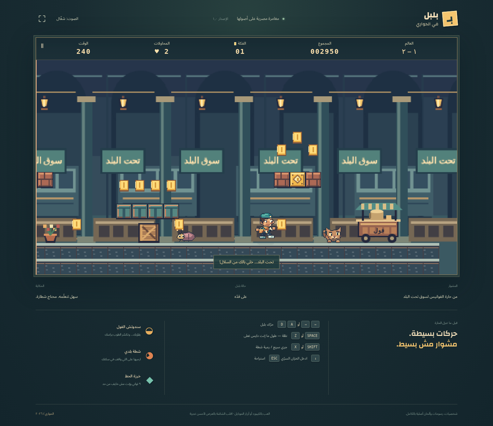
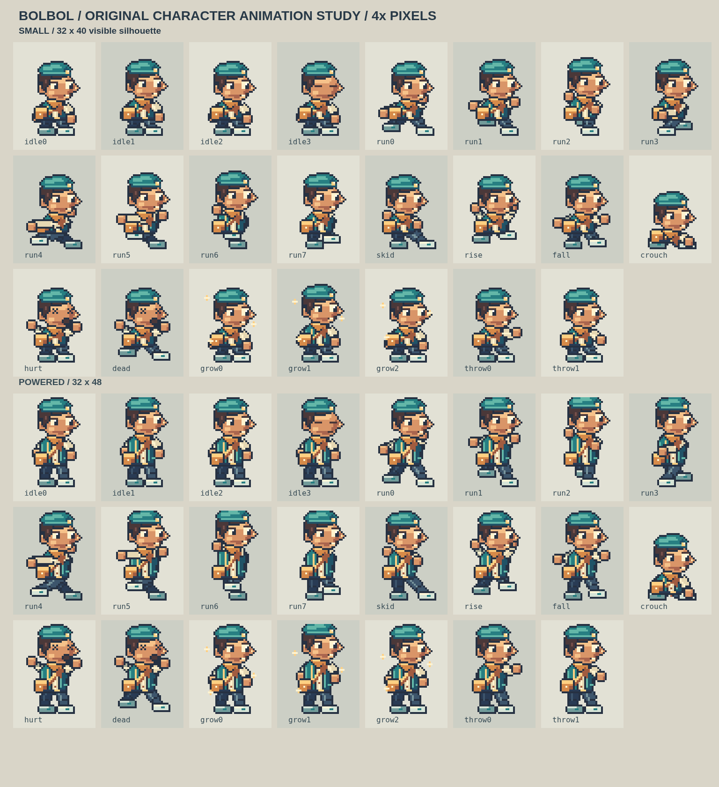
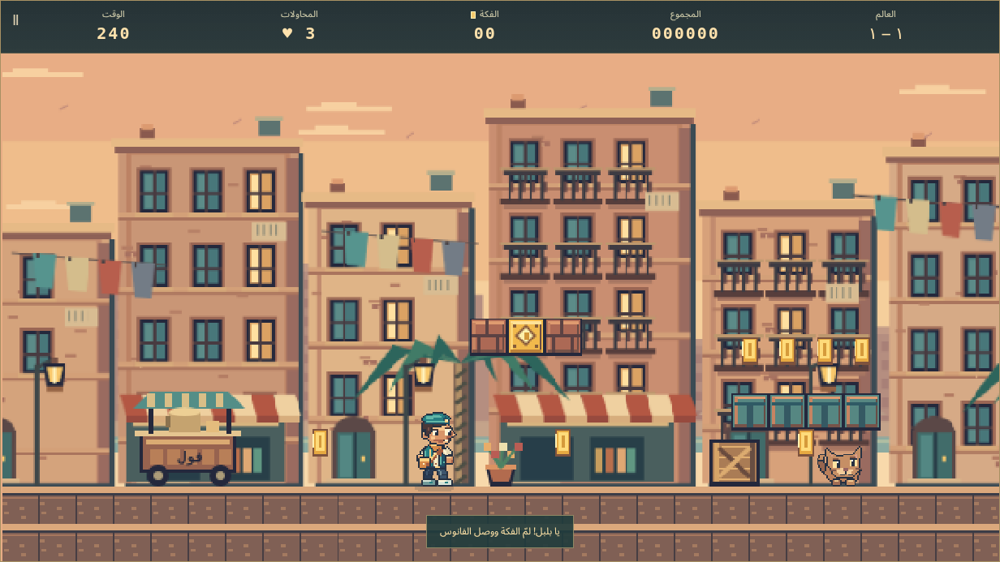

# بلبل في الحواري

An original Egyptian side-scrolling platformer. Race through lantern-lit alleys and an underground market as **بلبل**, a blue-capped neighbourhood courier. All characters, layouts, pixel art, sound effects and music were created specifically for this game.



## Play

- **Move:** arrows or A / D.
- **Jump:** Space, Z, W or ↑. Hold for a higher jump; release for a short hop.
- **Run / throw chili:** Shift or X. Shooting needs the chili pickup; press again for another throw.
- **Secret cistern:** stand on the turquoise tank and press ↓ / S. Use the far tank to leave.
- **Pause:** Escape or the pause button. Enter starts the game or advances after world 1.
- Touch controls appear automatically on touchscreen devices. Landscape is recommended.

## What's inside

- Two complete, original routes: **حارة الفوانيس** (4,992 px) and **سوق تحت البلد** (5,376 px).
- Acceleration, braking, variable-height jumps, 110 ms coyote time and 120 ms jump buffering.
- Animated arabesque treasure boxes, breakable bricks, spinning coins and debris/dust.
- Foul sandwiches for growth, chili for bouncing pepper shots, lucky beads for nine-second invulnerability.
- Angry alley cats, scuttling insects and baskets that stop when stomped and roll when kicked.
- Four to five pits per route, rooftop terraces, checkpoint lanterns, a secret treasure room and end lanterns.
- Three-layer parallax, shaded pixel sprites, eight-frame running, four idle drawings, skid, rise/fall, crouch, hurt/death, growth and chili-throw poses.
- Original two-voice chiptune scores and synthesized effects; mute and fullscreen controls.
- Three lives, 50-coin extra lives, countdown timer, detailed level-clear tally and a final result.
- Arabic RTL UI. Offline PWA with locally hosted fonts; no accounts, analytics or server required.




## Character artwork revision

بلبل now has a clear three-quarter face, embroidered teal waistcoat, cream shirt, amber scarf, courier satchel and two-tone sneakers. Small form has a 32×40 visible silhouette; powered form is 32×48. Both use consistent 32×48 canvases with no fractional sprite scaling. There are 23 poses per form (46 drawings), with a strictly opaque/transparent palette and top-left highlights. Enemy artwork was redrawn to the same palette and outline treatment.




## Local development

Node.js 22+ and npm are required.

```sh
npm ci
npm run dev
```

Open the local URL printed by Vite. Production:

```sh
npm run check
npm run preview
```

### Scripts

| Command                | Purpose                                                                                             |
| ---------------------- | --------------------------------------------------------------------------------------------------- |
| `npm run dev`          | Local Vite server                                                                                   |
| `npm run build`        | Strict TypeScript check + production bundle                                                         |
| `npm run check`        | Typecheck, lint, formatting, unit tests, build                                                      |
| `npm test`             | Deterministic physics/scoring/level rules                                                           |
| `npm run test:browser` | Browser controls, collisions, power-ups, transitions and touch checks (dev server must be running)  |
| `npm run test:routes`  | Traverse both full routes with keyboard input; grants temporary invulnerability to isolate geometry |
| `npm run format`       | Format source and documentation                                                                     |

For browser tests: `npx playwright install chromium`. Screenshots are saved under `/workspace/hawari-shots` in this build environment. Set `GAME_URL` for the smoke and runtime scripts to test another origin.

## Structure

```text
src/
  art.ts       Egyptian scenery and environment tiles
  characters.ts Hand-pixelled 32×48 character frames, shaded outfits and expressive enemies
  hero-state.ts Pure animation selection and foot-aligned collision metrics
  audio.ts     Original Web Audio synthesizer and score
  game.ts      Platforming, collisions, enemies, rooms and game states
  rules.ts     Pure, unit-tested movement and scoring rules
  ui.ts        Arabic HUD, touch input and screen transitions
  style.css    Responsive cabinet and RTL UI
public/
  fonts/       SIL OFL-licensed Arabic fonts and licenses
  sw.js        Offline worker (precache injected during production build)
tests/         Unit and real-browser regression checks
```

## Deploy

Static Vite output is in `dist/`. Vercel settings are checked in: framework Vite, build `npm run build`, output `dist`. This application needs **no environment variables or credentials**. No production deployment has been created yet.

The build injects asset hashes and fonts into the service worker so the complete game is cached after the first successful installation. HTTPS or localhost is required for service workers. Increment the worker cache name for future releases. For rollback, redeploy the previous verified build.

## Design and limits

The art uses a warm sandstone / turquoise / amber palette, dark contours, consistent highlights and three background layers. The base canvas is 640×360 with nearest-neighbour scaling; responsive fitting can use fractional scales on smaller displays. Gameplay is tuned for 60 fps; actual device performance varies.

This is a compact first release, not a large commercial game: two levels, one reusable bonus-room layout, no gamepad support, no saved mid-level progress, no remote leaderboards and no licensed or copied game assets. Returning from a bonus room rebuilds the outdoor route (while preserving score, time and checkpoint); its enemies/coins reset. The bonus room itself can only be entered once per run of that level.

## Credits and license

Game code and original art/audio: MIT. See [LICENSE](LICENSE) and [CREDITS.md](CREDITS.md). Arabic fonts retain their SIL Open Font License. Phaser is MIT-licensed. No third-party game art or audio is used.
